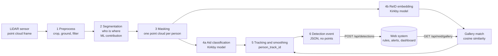

# From LiDAR frame to alert: how the pieces fit

This page answers three questions: what runs where, where the models are placed, and what travels between the parts. The code that follows this design is in `ml/pipeline/` and runs today with stand-in models, so the whole chain can be tried before any real weights are connected.

## The chain



| Step | What it does | Who owns it | Where it lives in code |
|---|---|---|---|
| 1 Preprocess | Crops to the room, removes floor and noise | ML | `Frame` input, `preprocess` hook |
| 2 Segmentation | Gives every point a person label (2 to 5 people per frame) | ML contribution (this project) | `Segmenter` |
| 3 Masking | Cuts the frame into one small point cloud per person, so each model sees one person only (FR10.2) | Pipeline | `mask_people` |
| 4a Aid classification | Label (none, cane, crutches, walker, wheelchair) and confidence | Kirkby model (PTv3) | `AidClassifier` |
| 4b ReID | Turns the person's points into an embedding vector | Kirkby model (ReID3D) | `ReIDEmbedder` |
| Gallery match | Compares the embedding with enrolled patients | Pipeline | `Gallery.match` |
| 5 Tracking | Keeps a stable `person_track_id`, smooths flicker over a few frames | Pipeline | `Tracker`, `TrackSmoother` |
| 6 Event | Builds the JSON of `contracts/detection-event.schema.json` and sends it | Pipeline | `Publisher` |

The web system never sees a point cloud, an embedding or a model. It sees events, and it keeps a registry of who is enrolled.

## What runs where

| Part | Where | Why |
|---|---|---|
| Sensor and the pipeline (steps 1 to 6) | **Carleton inference server**, next to the sensor | Participant point clouds stay on lab-controlled storage (decisions, 2026-10-21; NFR6.1) |
| Model weights, embedding files | Same server, in `models/` and `data/embeddings/` (both git-ignored) | Embeddings identify people, so they never leave it |
| Web system (`web/`) | Any host the care home can reach | It only receives events and sends notifications |
| Training | DRAC (SLURM), with public or synthetic data only | NFR6.1 |

## Where to put the models

On the inference server, outside git. The folder is read from the environment variable `MODELS_DIR` (default `./models`).

```
models/
  manifest.yaml                  names, versions, checksums (see ml/pipeline/models.example.yaml)
  segmentation/<version>/        your segmentation weights
  aid_classifier/<version>/      Kirkby PTv3 weights and its config
  reid/<version>/                Kirkby ReID3D weights and its config
data/
  embeddings/<embedding_ref>.npy one file per enrolled sample
  spool/                         events waiting for the web system to come back
```

Connecting a real model means writing one small class that satisfies an interface in `ml/pipeline/mobility_pipeline/interfaces.py` and naming it in the config. Nothing else changes. The classes in `kirkby_adapters.py` are the places to fill in; until then they refuse to run with a clear message, and the stand-ins in `stubs.py` are used instead (`MODELS=stub`).

## How enrolment works (FR1.3, FR1.4, section 7)

1. An admin records consent for the patient in the web system. Without consent nothing below is accepted.
2. Calibration samples of that patient (a few seconds of walking, with and without the aid, with and without a helper) are captured on the inference server.
3. `python -m mobility_pipeline enrol --patient P-0042 --aid walker sample.npy` makes an embedding with the ReID model and stores it as `data/embeddings/<ref>.npy`.
4. The command registers the reference with `POST /api/reid/enrol` (API key). The web system checks consent and stores only the reference.
5. Every minute the pipeline reads `GET /api/reid/gallery`, loads the listed embeddings, and **deletes any embedding file that is no longer listed**. This is what makes withdrawing consent or discharging a patient really remove the biometric data: the web system deletes the reference, and the service deletes the file on its next refresh.

## What one event looks like

```json
{ "event_id": "…uuid…", "timestamp": "2026-11-03T14:22:05Z", "room_id": "R-204", "person_track_id": "t-17",
  "identity": { "patient_id": "P-0042", "confidence": 0.91 },
  "aid": { "label": "none", "confidence": 0.97 },
  "event_type": "detection", "model_version": "seg-0.1+aid-0.3+reid-0.2" }
```

The pipeline sends the best match with its real confidence. It does **not** apply the web system's thresholds: the web system compares the confidences with the administrator's settings (identity 0.8, aid 0.6 by default) and puts weak detections into the review queue. Only when the best match is very weak (below `unknown_below`, default 0.30) does the pipeline say `patient_id: null`, meaning an unknown person such as staff or a visitor.

## Failure behaviour

| Failure | What happens |
|---|---|
| Web system unreachable | Events are retried, then written to `data/spool/` and sent when it returns |
| Web rejects an event (4xx) | Logged, not retried (a retry cannot fix it) |
| Gallery cannot be fetched | The last gallery is kept; the pipeline logs the age of its gallery |
| A model fails on one person | That person is skipped for that frame; the other people are still processed |
| The whole pipeline stops | **Nobody is alerted and the web system cannot tell.** See open question 5 |

## Open questions for Sean Kirkby and for you

These decide the last 10 percent of the connection. Each has a safe default in the code until it is answered.

1. **Input format.** What does each model read: a raw `N x 4` array (x, y, z, intensity), a voxel grid, a PCD file? Which sensor configuration and frame rate was it trained on?
2. **Class names.** The exact aid labels the classifier outputs (the schema and the database use `none, cane, crutches, walker, wheelchair`).
3. **ReID output.** Embedding size, and whether to compare with cosine or Euclidean distance. The code assumes cosine on L2-normalised vectors.
4. **Does the classifier want a masked cloud or the whole frame?** The design assumes one masked person per call.
5. **Heartbeat.** Should the pipeline send a heartbeat so the dashboard can show "monitoring paused"? This is the one failure that is silent today. It is a small addition to both sides.
6. **Enrolment through the web page.** The upload screen in the admin interface could forward files to the inference server instead of the command line. That needs a small authenticated upload endpoint on the inference server and a decision about who may reach it.
7. **Confidence of identity.** Cosine similarity is not a probability. If the web thresholds are to mean something, the match score should be calibrated on held-out data (part of the evaluation chapter).
